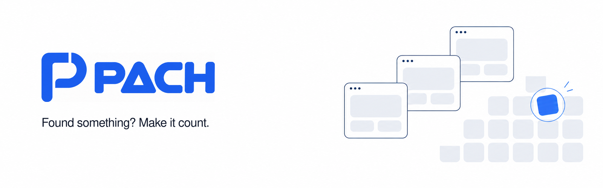

# Small discoveries. Better products.

PACH makes product testing playable. Try a broken checkout, spot the glitch, and help a fix move forward.

- **Play immediately.** Explore the demo and report a defect. No wallet needed.
- **Make it reproducible.** Game events and evidence give reviewers something concrete to check.
- **Follow the fix.** Controlled patches, human review, and funded testnet campaigns connect findings to resolution.

## Try it locally

Requires Node.js **22.12+** and the pnpm version pinned in `package.json`.

```sh
cp .env.example .env
pnpm install --frozen-lockfile
pnpm dev:offline
```

Open [the practice challenge](http://localhost:3000/play/checkout). This starts the web app and a demo API with in-memory storage.

See the [development guide](docs/DEVELOPMENT.md) for checks, or the [Monad Testnet guide](docs/TESTNET.md) for encrypted wallets, contract deployment, and rewards.

## Under the hood

Next.js · React · TypeScript · Node.js API · PostgreSQL · Solidity

**Prototype, not a live rewards service.** Test USDC has no monetary value. Practice earns no claimable rewards; funded campaigns require validation and authorized review. Controlled [testnet settlement is verified](docs/releases/2026-10-24-monad-testnet.md); public app hosting remains pending.

[Development](docs/DEVELOPMENT.md) · [Deployment](docs/DEPLOYMENT.md) · [Contracts](packages/chain/README.md) · [Release checklist](docs/RELEASE_CHECKLIST.md)
